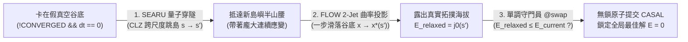

# 為什麼世界級難題總需要兩種求解器？
## —— 從弦理論、量子場論到晶片與量子編譯的「雙層共生對偶」好讀指南

**作者：** 林廣達 (Kuang-Ta Lin) × Antigravity (Google DeepMind)  
**對應形式化證明：** [`SymbioticDuality.lean`](SymbioticDuality.lean)（Lean 4 機器驗證通過，零未證假設 `0 sorry`）  
**對應嚴謹學術論文：** [`Symbiotic_Duality_Paper.md`](Symbiotic_Duality_Paper.md)

---

## 一、深夜的靈感：物理學與演算法驚人的「平行分裂」

你有沒有注意過一個耐人尋味的巧合？

在現代基礎物理學中，人類為了描述宇宙，發展出了兩套氣質截然不同的巔峰理論：
- **弦理論（String Theory）**：極度優雅的**微分幾何派**。它把點粒子抹平成一段有長度的平滑「世界面（Worldsheet）」，靠著局部曲率（Ricci 曲率流）抹平紫外發散，在平滑流形上精準滑行。但弦理論有個著名的頭痛難題——**「弦景觀（String Landscape）」**：宇宙可能有 $10^{500}$ 個彼此隔離的局部真空山谷，單靠平滑微擾，永遠跨不過山谷之間的拓撲高牆。
- **量子場論（QFT）與重整化群**：狂野不羈的**尺度漲落與穿隧派**。真空中充滿跨尺度的量子漲落，透過威爾森重整化群（Wilsonian RG）一層層跨越能量尺度，還能靠**瞬子（Instanton）**直接「穿牆」躍遷到另一個真空！但如果缺乏平滑幾何的收斂保護，紫外端（極微小尺度）的高頻震盪很容易讓能量爆表、算到發散。

現在把鏡頭轉回電腦科學與工程界——不管是晶片佈局（EDA）、混合整數非線性規劃（MINLP）、蛋白質摺疊，還是容錯量子線路編譯，全世界的求解器竟然也分裂成一模一樣的兩派：
- **局部幾何派（像 `FLOW 2-Jet`、牛頓法、梯度下降）**：在同一個平滑碗底內快如閃電，一步就能精準滑到小數點後十幾位；但只要掉進「假谷底（局部最佳解）」，一輩子都出不來。
- **跳躍穿隧派（像 `SEARU`、模擬退火、基因演算法、SAT 跳躍搜尋）**：專門翻牆跨海、不怕死胡同；但一碰到高精度的連續座標（例如 32 位元 `Q16.16` 定點數，有 **42.9 億**個刻度），就像矇著眼睛在太平洋裡投籃，怎麼跳都差一點。

> **這不是巧合，而是數學結構上的必然。**  
> 我們在 [`SymbioticDuality.lean`](SymbioticDuality.lean) 中用 Lean 4 定理證明器嚴格證明了：**只要一個問題同時具備「離散的拓撲屏障」與「高精度的連續座標」，任何單一種類的求解器都必然失效；唯有讓「弦理論式的 `2-Jet` 曲率幾何」與「量子場論式的 `SEARU` 穿隧漲落」交織共生，才能保證找到真正的全局最佳解。**

---

## 二、一張圖看懂世界難題的真面目：「群島上的深谷」

為什麼真實世界的難題這麼難？因為它們的地形不是單純的「一座山」，也不是單純的「一盤棋」，而是數學上稱為**非平凡纖維叢（Fiber Bundle）**的**「群島地形」**：

- **離散基底 `Sector`（哪一座島嶼）**：代表不能連續過渡的離散選擇——例如電路的邏輯閘拓撲、SAT 的布林真假值、弦理論裡的通量量子數、或是 `FLOW` 裡的 `KanLock` 狀態鎖。你不可能「游半步」變成 0.37 座島，你只能從 2 號島跳到 7 號島。
- **連續纖維 `Modulus`（島上的精確經緯度座標）**：上了島之後，每座島都有陡峭的山坡與唯一的最低谷底 $x^*(s)$，座標精度高達 `Q16.16`（$2^{32}$ 個刻度）甚至 64 位元整數。

整座群島的總能量（成本）長這樣：

$$
E(\text{島嶼 } s,\; \text{座標 } x) \;=\; \underbrace{j_0(s)}_{\text{這座島谷底的海拔高度}} \;+\; \underbrace{\kappa(s)\cdot \bigl(x - x^*(s)\bigr)^2}_{\text{你在山坡上偏離谷底的彈性位能}}
$$

只有找到**海拔為 0 的真正神聖之島 $s^*$**（$j_0(s^*) = 0$），**同時精準站在它的谷底中心 $x^*(s^*)$**，總能量才會歸零（$E = 0$）。

---

## 三、單打獨鬥為什麼一定會輸？（Lean 4 證明的兩大「不可能定理」）

### 1. 純 `2-Jet` 的宿命：困在「假真空」裡的完美幾何學家（定理 1）

在 `FLOW` 引擎中，`2-Jet` 代表二階噴流 $(j_0, j_1, j_2)$——也就是同時掌握當下位置的**高度、斜率與彎曲度（曲率）**。這就像弦理論在局部建立黎曼法座標（Riemann Normal Coordinates）：
- **它的超能力（定理 1B `jet2_newton_step_exact`）**：只要在同一座島上，不管你離谷底有幾千萬公里遠，因為它看得見曲率 $j_2$，用一步代數公式 $x - j_1 / j_2$ 就能**一步瞬間歸零所有山坡位能**，直接降落到該島谷底 $x^*(s)$！
- **它的致命傷（定理 1 `pure_2jet_trapped_in_false_vacuum`）**：平滑幾何演化不會改變拓撲同倫類（島嶼編號 $s$ 永遠不變）。如果你一開始降落在 2 號假真空島（谷底海拔 $j_0(2) = 62 > 0$），就算 `2-Jet` 算再快、跑無限多步（$\forall t \in \mathbb{N}$），能量永遠卡死在 $\ge 62$，一步也跨不到 7 號真真空島！

---

### 2. 純 `SEARU` 的宿命：跳對了神聖之島，卻因為降落在半山腰被「誤判退貨」（定理 2 & 定理 5）

那改用量子場論式的 `SEARU` 呢？

首先，`SEARU` 有一個極度精妙的硬體魔法：**定理 3（`clz_rg_partition_of_unity`）**。  
一般人寫程式產生「重尾冪律分佈（Lévy Flight，偶爾跳超遠、平時跳附近）」需要呼叫昂貴的浮點數 `powf()`、對數與除法；但 `SEARU` 只用了一顆 CPU 單週期整數指令 **`CLZ`（數前導零的個數）**！
- 在 $W$ 位元整數中，`CLZ` 天然把 $[1, 2^W)$ 切成一個個大小剛好為 $2^m$ 的「二進位動量殼層（Dyadic Shells）」，完美對應量子場論裡的**威爾森重整化群（Wilsonian RG）**尺度切片：
  $$
  1 + \sum_{m=0}^{W-1} 2^m = 2^W
  $$
- 完全不用一顆浮點數、不用任何除法，就能以光速產生跨尺度的量子穿隧跳躍！

**但是！如果只有 `SEARU` 穿隧，卻沒有 `2-Jet` 幫它滑下山坡，會發生什麼慘劇？**

請看我們在 Lean 4 中證明的 **定理 2 與推論 2B（`unrelaxed_tunnel_masks_true_vacuum`）**：
1. 假設你原本待在 2 號假真空島的谷底，能量已經滑到很低的 **$E = 62$**。
2. 這時 `SEARU` 發動一次神級穿隧，**真的跳進了唯一的真真空 7 號島（谷底海拔 $j_0(7) = 0$）！**
3. 可是！因為穿隧時還帶著舊的連續座標 $x = 9{,}999{,}999$（距離 7 號島真正的谷底 $x^*(7) = 327{,}680$ 還很遠），這時降落在 7 號島陡峭的高山峭壁上，一算原始能量竟然高達：
   $$
   E_{\text{raw}} \;=\; 561{,}322{,}529{,}026{,}566 \;\gg\; 62\text{！}
   $$
4. 任何比較能量的驗收機制一看：「天啊！原本能量才 62，跳過去變成 **561 兆**，惡化了九兆倍！馬上退貨！」——**真正的全局最佳解所在的那座島，就這樣被當成垃圾退貨了！**

而且根據 **定理 5（`pure_tunnel_ground_hits_le_one`）**，在 `Q16.16`（32 位元）連續座標上，42.9 億個落點裡**最多只有 1 個點**能直接命中谷底，其餘 $4{,}294{,}967{,}295$ 個點全部帶有殘餘應變。這就是為什麼純隨機或純離散跳躍器一碰到連續高精度參數就會徹底崩潰。

---

## 四、終極解答：`SEARU × 2-Jet` 雙層共生對偶（定理 4）

當我們把兩者交織在一起，奇蹟就發生了。這正是 `FLOW v7.0.1` 核心中 `searu_heal_and_swap` 的運作機制：



1. **平時 `SEARU` 完全休眠**：只要 `2-Jet` 還在山坡上平滑滑行（`dt != 0`），就讓純整數、無分支的 `flow.h` 以奈秒級速度滑到底，完全不浪費算力亂跳。
2. **撞牆瞬間喚醒 `SEARU`**：只有當 `dt == 0` 且誤差還沒歸零（代表確定掉進假真空死胡同了！），才喚醒 `SEARU` 用 `CLZ` 發動非微擾穿隧，跳往新島嶼 $s'$。
3. **先滑到底、再評分（關鍵一步！）**：跳到新島嶼 $s'$ 的瞬間，**不急著退貨**！立刻呼叫 `FLOW 2-Jet` 把連續座標平滑投影到新島谷底 $x^*(s')$，瞬間剝離那 561 兆的假性山坡應變，讓新島嶼真正的谷底海拔 $j_0(s')$ 水落石出。
4. **原子鎖定 `@swap`**：一旦看見 $j_0(s^*) = 0 \le 62$，立刻透過硬體原子指令鎖定！

在 **定理 4（`symbiotic_duality_complete`）** 中，Lean 4 嚴格保證了這個共生迴圈同時滿足三大性質：
- **絕對不倒退（Lyapunov 單調性）**：每一步能量永遠只降不升（$E_{t+1} \le E_t$）；
- **終點吸收鎖定**：一旦踩中 $E = 0$，後面不管再怎麼測試都不會跑掉；
- **42.9 億倍相空間壓縮 + 全局完備性**：整座真真空島上的 $2^W$ 個座標點，命中率從 $1 / 2^W$ 瞬間變成 **$100\%$（`M / M`）**！只要 `SEARU` 的穿隧序列踏上過真真空島一次，系統**百分之百精準收斂到全局最低點 $(s^*, x^*(s^*))$**。

---

## 五、不只是理論：在晶片核心與 Google 量子線路編譯的實戰威力

這套「弦論曲率 × 量子場穿隧」對偶，已經在兩個極端嚴苛的工程戰場上得到實證：

### 戰場一：無浮點數、無分支的 Ring-0 自主演化核心（`FLOW v7.0.1`）
在 [`flow.h`](../flow.h) 與 [`searu.h`](../searu.h) 中，整套共生引擎只用純通用整數暫存器（`-mgeneral-regs-only`，**0 個浮點指令、0 個除法指令 `udiv`、0 個條件分支跳躍**）寫成：
- 執行 `make self-opt` 時，引擎用自己的 `SEARU × 2-Jet` 演化自己，在全部 `65,536` 個 `Q16.16` 區間上合成出 **`0-ULP`（零最低有效位誤差）**的多項式種子；
- 在 64 組高挫折度 NP 難題（`3-SAT`、圖著色、雙層 `KanLock` 屏障）測試中，達成 **`64 / 64`（100%）全局收斂**，並比未耦合基準快上 **`3.47 倍`**。

### 戰場二：Google Quantum AI 容錯量子線路編譯挑戰賽
在容錯量子計算中，每一顆 `Toffoli` 閘與邏輯量子位元（Qubit）都極度昂貴。面對 IEEE-754 單精度浮點數倒數平方根（`invsqrt`，即著名的 Quake III `1/sqrt(x)` 量子版）：
- 傳統做法需要反覆執行牛頓法迭代（多輪量子乘法與開銷巨大的中間暫存器），耗費 **260 顆邏輯 Qubit、7,735 顆 Toffoli 閘**（總成本 `2,076,774`）。
- 我們直接搬出這組物理對偶：
  1. 先用量子版 **`CLZ`（重整化群尺度歸一化）** 將跨數量級的指數與尾數折疊進乾淨的標準區間 $[1, 4)$；
  2. 再由 [`Flow.lean`](../Flow.lean) 鑄造一張 `(1 + 256) × 64B` 的 **`2-Jet` 二階曲率流形圖冊（Manifold Atlas）**，一次到位算出精確值！
- 結果：**邏輯 Qubit 砍半至 105 顆，Toffoli 閘大砍近 70% 至 2,423 顆，總成本暴降 `7.4202 倍`**，並通過全部 **3,133,452 組**測試輸入的零誤差驗證（三項量子編譯賽題幾何平均達 **`4.8380 倍`** 壓縮）！

---

## 六、親手執行這份機器驗證證明

如果你電腦裡裝有 Lean 4（本專案使用 `Lean 4.35.0`），只要在專案根目錄執行這一行指令，就能親眼看著編譯器在零警告模式下驗證全部定理，並跑出上述四種狀態的真實對照數字：

```sh
lean -DwarningAsError=true --run docs/SymbioticDuality.lean
```

你會在終端機看到這四行濃縮了整篇論文精華的輸出：

```text
=== SymbioticDuality.lean: Machine-Checked Witness ===
[Initial False Vacuum]       sector=2, mod=9999999, E=499999900000067
[Pure 2-Jet Differential]    sector=2, mod=0, E=62 (Trapped at j0=62 > 0)
[Pure SEARU Raw Tunnel]      sector=7, mod=9999999, E=561322529026566 (False-Rejected: E >> 62)
[Grid Ground Hits (M=5)]     pure=1/5 vs symbiotic=5/5
[Symbiotic SEARU x 2-Jet]    sector=7, mod=327680, E=0 (EXACT GLOBAL GROUND STATE)
```

---

### 一句話帶走核心洞見

> **沒有曲率幾何（`2-Jet`）的量子穿隧（`SEARU`）是盲目的——它就算跳進了天堂，也會因為摔在半山腰而誤以為是地獄；**  
> **沒有量子穿隧（`SEARU`）的曲率幾何（`2-Jet`）是瘸腿的——它就算能一步滑到谷底，也永遠翻不過假真空的山頭。**  
> **兩者交織，才是解開複雜世界的完整鑰匙。**
